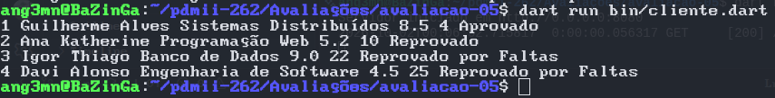
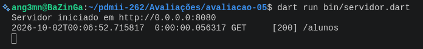

Criar um cliente http que acessa o servidor Web definido na atividade-04. 

1) Modifique a lista de alunos no servidor web de forma a ter a seguinte estrutura:

    Aluno(id, nome, Disciplina, Media, Faltas).

2) Na aplicação Cliente Web acesse todos os Alunos registrados no Servidor Web.

Liste-os e teste a seguinte condição de forma a imprimir uma única mensagem

Se Media < 6.0 
      print "Reprovado"
Se Não
     print "Aprovado"
Se Faltas > 20 
      print "Reprovado por Faltas".

OBS: 
Imprimir todos os alunos no formato:

ID NOME DISCIPLINA MEDIA FALTAS MENSAGEM